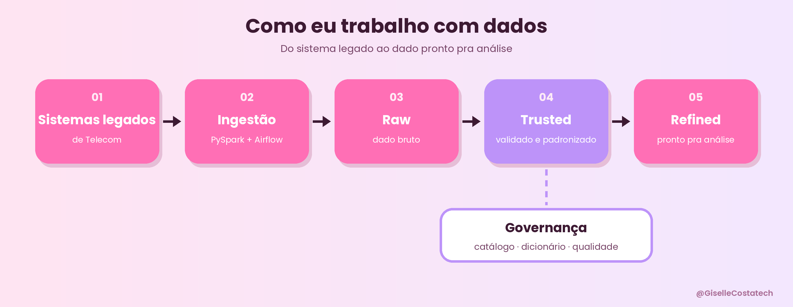

---

### 💗 Sobre mim

* 👩‍💻 Engenheira de Dados na Global Hitss, em projeto para a Claro (América Móvil).

* 🏗️ Construo pipelines de ingestão em larga escala com PySpark, OCI Dataflow e Airflow, levando dados de sistemas legados de Telecom para um Data Lakehouse.

* 🔍 Cuido de governança de dados: catálogo, dicionário de dados, padronização de esquemas e qualidade.

* ☁️ AWS Certified Cloud Practitioner.

* 💜 Fundadora da Tech Girls, comunidade de mentoria para mulheres na tecnologia.

* 📍 Rio de Janeiro, RJ.

---

### 📊 Como eu trabalho com dados

* **Sistemas legados de Telecom** ➡️ **Ingestão (PySpark + Airflow)** ➡️ **Raw (Dado Bruto)** ➡️ **Trusted (Validado e Padronizado)** ➡️ **Refined (Pronto para análise)** & **Governança (Catálogo e Qualidade)**.

---

### 🛠️ Stack & Ferramentas

---

### 🚀 Projetos em destaque

| Projeto | O que faz | Stack |

| :--- | :--- | :--- |

| **[Pipeline de Auditoria de Telecom](https://github.com/GiselleCostatech)** | Auditoria automatizada de bilhetagem com validação de qualidade de dados | DuckDB, dbt, Airflow |

---

### 🐍 Minhas contribuições

<picture>
<source media="(prefers-color-scheme: dark)" srcset="https://raw.githubusercontent.com/GiselleCostatech/GiselleCostatech/output/github-contribution-grid-snake-dark.svg">
<source media="(prefers-color-scheme: light)" srcset="https://raw.githubusercontent.com/GiselleCostatech/GiselleCostatech/output/github-contribution-grid-snake.svg">

</picture>

---

### 🌐 Vamos conectar?

 
