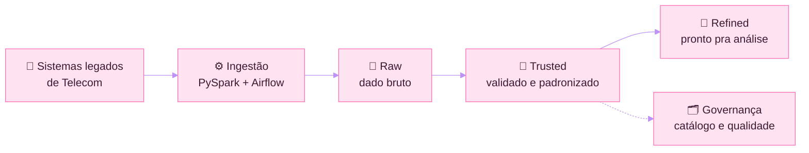

  

  

  
  
  

---

### 💗 Sobre mim

- 👩‍💻 **Engenheira de Dados** na Global Hitss, em projeto para a **Claro (América Móvil)**
- 🏗️ Construo **pipelines de ingestão em larga escala** com PySpark, OCI Dataflow e Airflow, levando dados de sistemas legados de Telecom para um **Data Lakehouse**
- 🗂️ Cuido de **governança de dados**: catálogo, dicionário de dados, padronização de esquemas e qualidade
- ☁️ **AWS Certified Cloud Practitioner**
- 💜 Fundadora da **Tech Girls**, comunidade de mentoria para mulheres na tecnologia
- 📍 Rio de Janeiro, RJ

---

### 🔄 Como eu trabalho com dados

---

### 🛠️ Stack

  
  
  
  
  
  
  
  
  
  
  

---

### 🚀 Projetos em destaque

| Projeto | O que faz | Stack |
|---|---|---|
| [Pipeline de Auditoria de Telecom](https://gisellecostatech.github.io/) | Auditoria automatizada de bilhetagem com validação de qualidade de dados | DuckDB · dbt · Airflow |

---

### 🐍 Minhas contribuições

  <picture>
    <source media="(prefers-color-scheme: dark)" srcset="https://raw.githubusercontent.com/GiselleCostatech/GiselleCostatech/output/github-contribution-grid-snake-dark.svg">
    
  </picture>

---

  
  💗 Feito com dados, café e muita mulher em tecnologia

